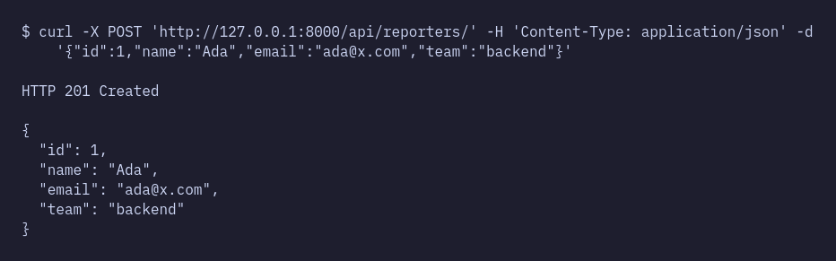
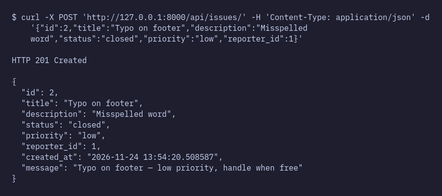
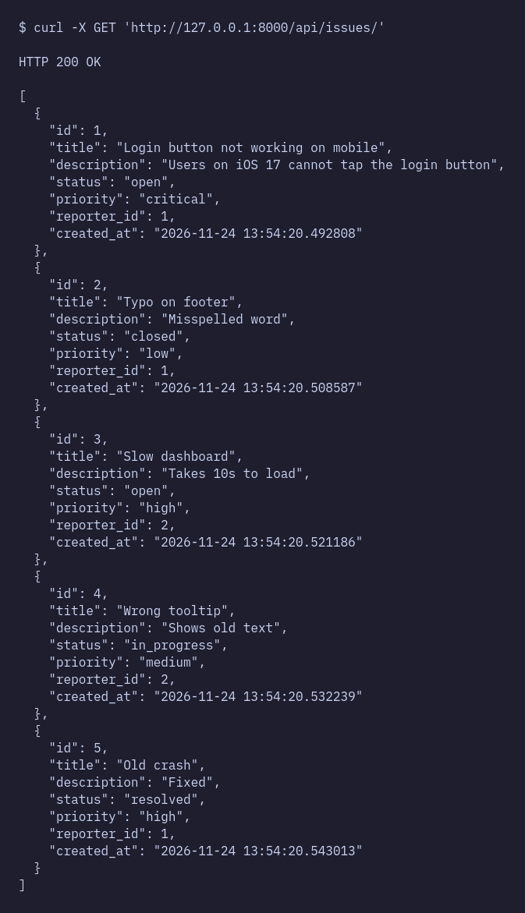
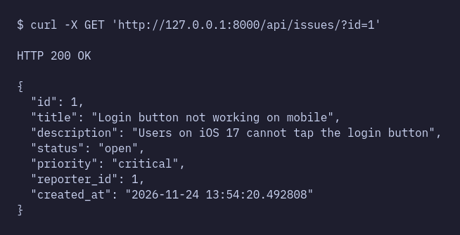
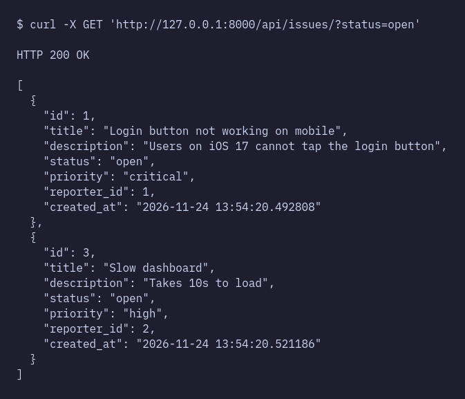
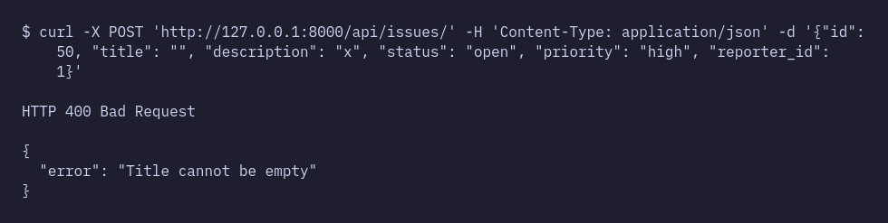
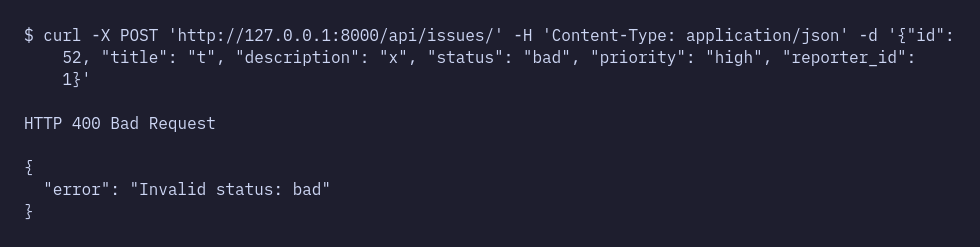
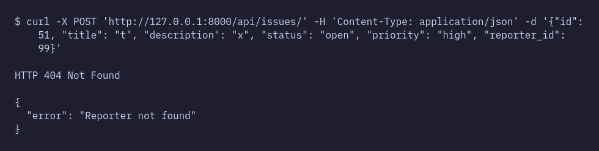
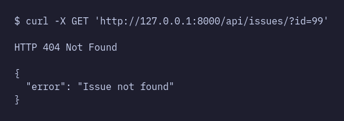
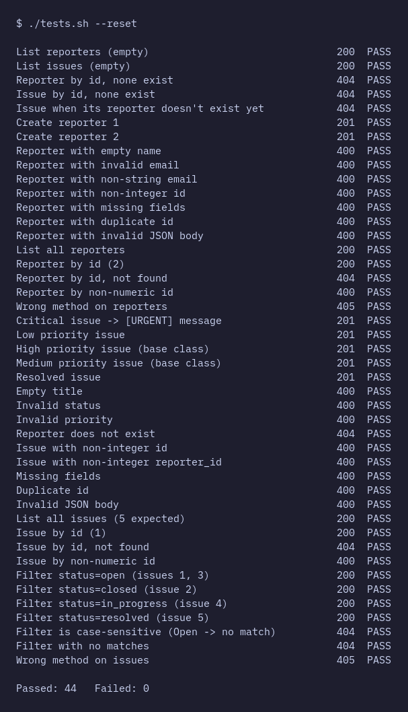

# DevTrack

A minimal backend API for tracking engineering issues (a stripped-down GitHub Issues), built with Django and Django REST Framework. Engineers (reporters) file issues, assign priorities and track status. Data is stored in two JSON files, `reporters.json` and `issues.json`.

## Project structure

```
assignment_2/
├── manage.py
├── devtrack/
│   ├── settings.py
│   └── urls.py          # routes /api/ to the issues app
├── issues/
│   ├── models.py        # OOP classes: BaseEntity, Reporter, Issue, CriticalIssue, LowPriorityIssue
│   ├── views.py         # endpoints and JSON file persistence
│   └── urls.py
├── tests.sh             # curl-based test script (44 tests)
├── test_output.txt      # saved output of the last test run
└── screenshots/
```

## How to run

Requires Python 3 and Django (6.1) with Django REST Framework.

```bash
python -m venv .venv
source .venv/bin/activate
pip install django djangorestframework
python manage.py runserver
```

The API is then available at `http://127.0.0.1:8000/api/`. `reporters.json` and `issues.json` are created next to `manage.py` on the first POST.

## OOP design

- `BaseEntity` is an abstract base class with an abstract `validate()` and a concrete `to_dict()`.
- `Reporter` and `Issue` both inherit from `BaseEntity`.
- `CriticalIssue` and `LowPriorityIssue` inherit from `Issue` and override `describe()`. The POST `/api/issues/` view picks the class from the priority (`critical` -> `CriticalIssue`, `low` -> `LowPriorityIssue`, otherwise `Issue`) and returns `describe()` as `message`.
- One reporter can file many issues (1:many). The reporter's id is stored in the issue as `reporter_id`.

## Endpoints

### Reporters

| Method | URL | Description |
|---|---|---|
| POST | `/api/reporters/` | Create a reporter. Body: `id`, `name`, `email`, `team` |
| GET | `/api/reporters/` | Get all reporters |
| GET | `/api/reporters/?id=1` | Get a single reporter by id |

### Issues

| Method | URL | Description |
|---|---|---|
| POST | `/api/issues/` | Create an issue. Body: `id`, `title`, `description`, `status`, `priority`, `reporter_id`. The response includes a `message` from `describe()` |
| GET | `/api/issues/` | Get all issues |
| GET | `/api/issues/?id=1` | Get a single issue by id |
| GET | `/api/issues/?status=open` | Get all issues with the given status |

Allowed `status` values: `open`, `in_progress`, `resolved`, `closed`. Allowed `priority` values: `low`, `medium`, `high`, `critical`. `created_at` is set automatically.

### Responses

| Code | Meaning |
|---|---|
| 200 | Successful GET |
| 201 | Created |
| 400 | Validation failure, missing fields, duplicate id, non-integer id, or invalid JSON |
| 404 | Reporter or issue not found, or no issues match the status filter |
| 405 | HTTP method not allowed |

Errors are returned as JSON, for example `{"error": "Title cannot be empty"}`. (Invalid JSON bodies are rejected by Django REST Framework itself with a `{"detail": ...}` message.)

## Design decision

The "find a record" loops (by id for reporters and issues, and by status for issues) were needed in several places: the GET handlers, the duplicate-id checks on POST, and the reporter-exists check when creating an issue. Instead of repeating the loop each time, I wrote `get_reporter_by_id()`, `get_issue_by_id()` and `get_issues_by_status()` once and call them wherever they are needed. This removes the duplication, keeps the views short and readable, and means a change to the lookup logic only has to be made in one place.

## Testing

All endpoints were tested with curl. `tests.sh` runs 44 tests (successes, validation failures, not-found cases and edge cases), prints each command with its response and checks the HTTP status. The server must be running first:

```bash
./tests.sh --reset                    # --reset deletes issues.json and reporters.json first
./tests.sh --reset > test_output.txt  # save the output
```

Result of the last run: **44 passed, 0 failed** (full output in `test_output.txt`).

The screenshots below are images of the actual curl commands and responses (JSON pretty-printed for readability).

### Screenshots: success cases

**POST /api/reporters/ - 201 Created**



**POST /api/issues/ (critical) - 201 Created with [URGENT] message**

![POST /api/issues/ (critical) - 201 Created with [URGENT] message](screenshots/02_create_critical_issue_201.png)

**POST /api/issues/ (low) - 201 Created with low priority message**



**GET /api/issues/ - 200 OK**



**GET /api/issues/?id=1 - 200 OK**



**GET /api/issues/?status=open - 200 OK**




### Screenshots: failure cases

**POST /api/issues/ with empty title - 400 Bad Request**



**POST /api/issues/ with invalid status - 400 Bad Request**



**POST /api/issues/ with unknown reporter - 404 Not Found**



**GET /api/issues/?id=99 - 404 Not Found**




### Test summary

**tests.sh - all 44 tests**




### All tests

| # | Test | Request | Status | Output | Result | Screenshot |
|---|---|---|---|---|---|---|
| 1 | List reporters (empty) | `GET /api/reporters/` | 200 | list of 0 record(s) | Pass | - |
| 2 | List issues (empty) | `GET /api/issues/` | 200 | list of 0 record(s) | Pass | - |
| 3 | Reporter by id, none exist | `GET /api/reporters/?id=1` | 404 | Reporter not found | Pass | - |
| 4 | Issue by id, none exist | `GET /api/issues/?id=1` | 404 | Issue not found | Pass | - |
| 5 | Issue when its reporter doesn't exist yet | `POST /api/issues/` | 404 | Reporter not found | Pass | - |
| 6 | Create reporter 1 | `POST /api/reporters/` | 201 | record id=1 | Pass | [view](screenshots/01_create_reporter_201.png) |
| 7 | Create reporter 2 | `POST /api/reporters/` | 201 | record id=2 | Pass | - |
| 8 | Reporter with empty name | `POST /api/reporters/` | 400 | Name cannot be empty | Pass | - |
| 9 | Reporter with invalid email | `POST /api/reporters/` | 400 | Invalid email | Pass | - |
| 10 | Reporter with non-string email | `POST /api/reporters/` | 400 | Invalid email | Pass | - |
| 11 | Reporter with non-integer id | `POST /api/reporters/` | 400 | ID must be an integer | Pass | - |
| 12 | Reporter with missing fields | `POST /api/reporters/` | 400 | Missing fields: email, team | Pass | - |
| 13 | Reporter with duplicate id | `POST /api/reporters/` | 400 | Reporter with this ID already exists | Pass | - |
| 14 | Reporter with invalid JSON body | `POST /api/reporters/` | 400 | JSON parse error - Expecting value: line 1 column 1 (char 0) | Pass | - |
| 15 | List all reporters | `GET /api/reporters/` | 200 | list of 2 record(s) | Pass | - |
| 16 | Reporter by id (2) | `GET /api/reporters/?id=2` | 200 | record id=2 | Pass | - |
| 17 | Reporter by id, not found | `GET /api/reporters/?id=99` | 404 | Reporter not found | Pass | - |
| 18 | Reporter by non-numeric id | `GET /api/reporters/?id=abc` | 400 | Invalid reporter ID | Pass | - |
| 19 | Wrong method on reporters | `DELETE /api/reporters/` | 405 | Method "DELETE" not allowed. | Pass | - |
| 20 | Critical issue -> [URGENT] message | `POST /api/issues/` | 201 | [URGENT] Login button not working on mobile — needs immediate attention | Pass | [view](screenshots/02_create_critical_issue_201.png) |
| 21 | Low priority issue | `POST /api/issues/` | 201 | Typo on footer — low priority, handle when free | Pass | [view](screenshots/03_create_low_issue_201.png) |
| 22 | High priority issue (base class) | `POST /api/issues/` | 201 | Slow dashboard [high] | Pass | - |
| 23 | Medium priority issue (base class) | `POST /api/issues/` | 201 | Wrong tooltip [medium] | Pass | - |
| 24 | Resolved issue | `POST /api/issues/` | 201 | Old crash [high] | Pass | - |
| 25 | Empty title | `POST /api/issues/` | 400 | Title cannot be empty | Pass | [view](screenshots/04_empty_title_400.png) |
| 26 | Invalid status | `POST /api/issues/` | 400 | Invalid status: bad | Pass | [view](screenshots/05_invalid_status_400.png) |
| 27 | Invalid priority | `POST /api/issues/` | 400 | Invalid priority: urgent | Pass | - |
| 28 | Reporter does not exist | `POST /api/issues/` | 404 | Reporter not found | Pass | [view](screenshots/06_reporter_not_found_404.png) |
| 29 | Issue with non-integer id | `POST /api/issues/` | 400 | ID must be an integer | Pass | - |
| 30 | Issue with non-integer reporter_id | `POST /api/issues/` | 400 | Reporter ID must be an integer | Pass | - |
| 31 | Missing fields | `POST /api/issues/` | 400 | Missing fields: description, status, priority, reporter_id | Pass | - |
| 32 | Duplicate id | `POST /api/issues/` | 400 | Issue with this ID already exists | Pass | - |
| 33 | Invalid JSON body | `POST /api/issues/` | 400 | JSON parse error - Expecting value: line 1 column 1 (char 0) | Pass | - |
| 34 | List all issues (5 expected) | `GET /api/issues/` | 200 | list of 5 record(s) | Pass | [view](screenshots/07_list_issues_200.png) |
| 35 | Issue by id (1) | `GET /api/issues/?id=1` | 200 | record id=1 | Pass | [view](screenshots/08_issue_by_id_200.png) |
| 36 | Issue by id, not found | `GET /api/issues/?id=99` | 404 | Issue not found | Pass | [view](screenshots/10_issue_not_found_404.png) |
| 37 | Issue by non-numeric id | `GET /api/issues/?id=abc` | 400 | Invalid issue ID | Pass | - |
| 38 | Filter status=open (issues 1, 3) | `GET /api/issues/?status=open` | 200 | list of 2 record(s) | Pass | [view](screenshots/09_filter_status_open_200.png) |
| 39 | Filter status=closed (issue 2) | `GET /api/issues/?status=closed` | 200 | list of 1 record(s) | Pass | - |
| 40 | Filter status=in_progress (issue 4) | `GET /api/issues/?status=in_progress` | 200 | list of 1 record(s) | Pass | - |
| 41 | Filter status=resolved (issue 5) | `GET /api/issues/?status=resolved` | 200 | list of 1 record(s) | Pass | - |
| 42 | Filter is case-sensitive (Open -> no match) | `GET /api/issues/?status=Open` | 404 | No issues found with the specified status | Pass | - |
| 43 | Filter with no matches | `GET /api/issues/?status=nothing` | 404 | No issues found with the specified status | Pass | - |
| 44 | Wrong method on issues | `DELETE /api/issues/` | 405 | Method "DELETE" not allowed. | Pass | - |
